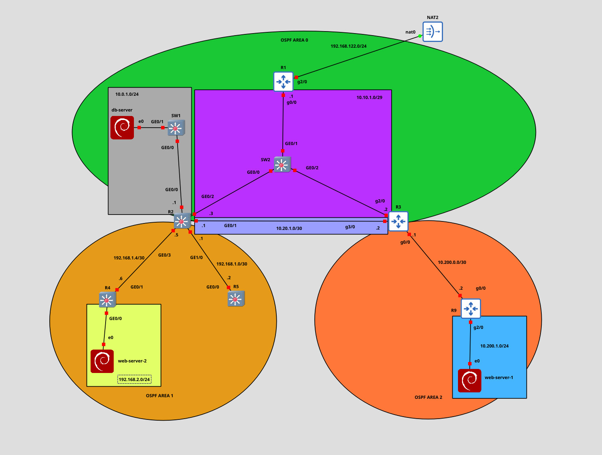

# Multi-area OSPF Lab: DHCP, DNS and NAT (GNS3)

A mid-level lab on Cisco routers and multilayer switches. Three OSPF areas share one backbone, three Debian servers get their addresses from DHCP, and **R1** is the DNS resolver and the NAT boundary in front of a GNS3 NAT cloud.

You will build four things and then prove them:

1. **OSPF** connects every internal subnet. Area 0 has two paths between the ABRs. Area 1 and Area 2 authenticate with different algorithms.
2. **DHCP** on R2, R4 and R9 addresses the servers. **DNS** on R1 answers for the lab zone and forwards everything else.
3. **web-server-1** and **web-server-2** can open a database session to **db-server**. Nothing else can.
4. **NAT** on R1 lets the servers reach the Internet to install packages, and lets a host on the outside SSH to each server through a fixed address. The server records that SSH session as coming from R1.

Rule of the lab: **predict first, then verify**. Before you look at a neighbor table, a routing table, or a translation table, write down what you expect. Predictions, filled worksheets, and answers to every theory question stay in that phase's file under `outputs/phaseN/`. Finished configurations go in `configs/`. This file is the lab statement. It does not contain configuration.

Lab keys in the tables below are part of the exercise. They are the only secrets that belong in this repository. Anything else you configure (local users, SNMP, enable secrets) stays out of the published configs.

---

## Table of contents

1. [Theory primer](#1-theory-primer)
2. [Equipment](#2-equipment)
3. [Topology and cabling](#3-topology-and-cabling)
4. [Addressing and services](#4-addressing-and-services)
5. [Feature placement](#5-feature-placement)
6. [Lab phases](#6-lab-phases)
   - [Phase 0: Build and hygiene](#phase-0-build-and-hygiene)
   - [Phase 1: Link addressing](#phase-1-link-addressing)
   - [Phase 2: Adjacencies](#phase-2-adjacencies)
   - [Phase 3: Routes](#phase-3-routes)
   - [Phase 4: DHCP](#phase-4-dhcp)
   - [Phase 5: DNS](#phase-5-dns)
   - [Phase 6: Outbound NAT](#phase-6-outbound-nat)
   - [Phase 7: Database path and ICMP](#phase-7-database-path-and-icmp)
   - [Phase 8: Inbound SSH](#phase-8-inbound-ssh)
   - [Phase 9: Write-up](#phase-9-write-up)
7. [Deliverables](#7-deliverables)

---

## 1. Theory primer

| Term | What it is | Where you meet it |
|---|---|---|
| **Backbone (Area 0)** | The area that joins every other area. Inter-area traffic crosses it. | R1, R2, R3, the subnet `10.10.1.0/29`, the subnet `10.20.1.0/30`, and the database LAN |
| **ABR** | A router with interfaces in the backbone and in at least one other area. It originates Type 3 summary LSAs. | R2 (Area 0 and Area 1), R3 (Area 0 and Area 2) |
| **ASBR** | A router that injects routing information from outside OSPF. | R1, which injects a default route toward the NAT cloud |
| **Network type** | A property of one segment. It decides whether that segment elects a DR, and which timers and neighbor rules apply. It is not a property of the area. | Broadcast on the three-router segment. Point-to-point on every link that has exactly two routers. |
| **DR / BDR** | On a broadcast segment, one designated router and one backup. The other routers are DROthers and form full adjacencies with the DR and the BDR. | `10.10.1.0/29` only |
| **Reference bandwidth** | Numerator of the interface cost: `cost = reference-bandwidth / interface bandwidth`. Cisco's default numerator treats a 1 Gbps link as cost 1. This lab does not use that default. | `10000` on every OSPF router, so the costs you calculate are comparable on both ends of a link |
| **Per-area authentication** | Each area has its own method and key. An ABR can speak a different method on each of its areas. Both ends of one link must agree. | Area 0 and Area 2: MD5, key `cisco`. Area 1: HMAC-SHA-256, key `cisco2` |
| **Inter-area route** | A prefix learned from another area, via the ABR. | A server LAN, seen from a router that does not sit on that LAN |
| **PAT (NAT overload)** | Many inside sources share one outside address. The translation keeps them apart with Layer 4 ports. | Server package installs, leaving through R1 |
| **Static destination NAT** | A fixed outside address is published for one inside host. | SSH to `.221`, `.222` and `.223` |
| **DHCP** | The router on the LAN hands out address, mask, gateway and DNS. | One pool on each server LAN |
| **Recursive DNS** | The resolver answers names it owns, and asks an upstream resolver for names it does not own. | R1 owns `lab.local` and forwards other names to `8.8.8.8` |

Interface cost is `reference-bandwidth / interface bandwidth`, integer division, with both values in Mbps on Cisco. The default reference bandwidth is 100. This lab sets it to **10000** on every OSPF router so that both ends of a link use the same numerator. Compute the costs in Phase 3 before you ask the router.

Platform limit: **R1, R3 and R9 are Cisco 7200 routers.** On that image OSPF authentication is plaintext or **MD5** only. **R2, R4 and R5 are L3 switches**, and those images are what speak **HMAC-SHA-256**. Area 1 uses HMAC-SHA-256, so it sits entirely on the switches. R2 is the ABR that speaks MD5 into Area 0 and HMAC-SHA-256 into Area 1. A 7200 in Area 1 cannot form that adjacency.

---

## 2. Equipment

| Device | Platform | Role |
|---|---|---|
| **R1** | Cisco 7200 | ASBR in Area 0. Originates the default route. DNS resolver for `lab.local`. NAT boundary. |
| **R2** | Cisco L3 switch | ABR between Area 0 and Area 1. DHCP server for the database LAN. |
| **R3** | Cisco 7200 | ABR between Area 0 and Area 2. |
| **R4** | Cisco L3 switch | Area 1 router. DHCP server for web-server-2. |
| **R5** | Cisco L3 switch | Area 1 router with a single transit link and a loopback. Source of the echo-requests the servers must drop. |
| **R9** | Cisco 7200 | Area 2 router. DHCP server for web-server-1. |
| **SW1** | Cisco L2 switch | One broadcast domain for `10.0.1.0/24`. No IP address. No OSPF. |
| **SW2** | Cisco L2 switch | One broadcast domain for `10.10.1.0/29`. No IP address. No OSPF. |
| **db-server** | Debian | Database host. DHCP client on `10.0.1.0/24`. |
| **web-server-1** | Debian | Web host in Area 2. DHCP client on `10.200.1.0/24`. |
| **web-server-2** | Debian | Web host in Area 1. DHCP client on `192.168.2.0/24`. |
| **NAT2** | GNS3 NAT cloud | Outside network `192.168.122.0/24`, attached on `nat0`. |

R1, R3 and R9 use the Cisco 7200 image. R2, R4 and R5 use the L3-switch image, because Area 1's HMAC-SHA-256 authentication is not available on the 7200. On those three switches every interface in the cabling table is a **routed port**, and IP routing is on. SW1 and SW2 only forward Ethernet frames: the ports in the cabling table on each of those switches are in the same broadcast domain.

The diagram labels interfaces as `g0/0` or `GE0/0`. Both mean `GigabitEthernet`. The guest name of a server NIC (`eth0`, `ens3`, `ens4`) may differ from the diagram label `e0`. Match the cable, then use the name the guest actually has.

R5 is intentional. It gives Area 1 a third router, a loopback you must reach from the other areas, and a source address the server firewalls treat differently from R4.

---

## 3. Topology and cabling



Why the drawing looks like this:

- **SW2** puts R1, R2 and R3 on one subnet, so Area 0 has a real multi-access segment with a DR election.
- **R2–R3** also has a separate `/30`. Area 0 therefore has two paths between the ABRs. You will predict which one carries traffic.
- **Area 1** is a hub (R2) with two point-to-point spokes. Three routers in an area do not make those spokes a broadcast network.
- **The grey, yellow and blue rectangles** are the only places servers live. Each is a stub LAN off one router.
- **The green cloud beyond R1** is outside OSPF. `192.168.122.0/24` is the GNS3 NAT network. Hosts on that subnet (typically the machine running GNS3) are the SSH clients for the inbound test.

### Cabling and addresses

Host addresses on `10.10.1.0/29` are `.1` (R1), `.2` (R3) and `.3` (R2).

| Device | Interface | Address | Connects to | Area | Network type |
|---|---|---|---|---|---|
| R1 | Gi0/0 | 10.10.1.1/29 | SW2 Gi0/1 | 0 | broadcast |
| R1 | Gi2/0 | DHCP | NAT2 nat0 | — | outside, no OSPF |
| R1 | Lo0 | 1.1.1.1/32 | — | 0 | loopback |
| R2 | Gi0/2 | 10.10.1.3/29 | SW2 Gi0/0 | 0 | broadcast |
| R2 | Gi0/1 | 10.20.1.1/30 | R3 Gi3/0 | 0 | point-to-point |
| R2 | Gi0/0 | 10.0.1.1/24 | SW1 Gi0/0 | 0 | you decide (Phase 2) |
| R2 | Gi0/3 | 192.168.1.5/30 | R4 Gi0/1 | 1 | point-to-point |
| R2 | Gi1/0 | 192.168.1.1/30 | R5 Gi0/0 | 1 | point-to-point |
| R2 | Lo0 | 2.2.2.2/32 | — | 0 | loopback |
| R3 | Gi2/0 | 10.10.1.2/29 | SW2 Gi0/2 | 0 | broadcast |
| R3 | Gi3/0 | 10.20.1.2/30 | R2 Gi0/1 | 0 | point-to-point |
| R3 | Gi0/0 | 10.200.0.1/30 | R9 Gi0/0 | 2 | point-to-point |
| R3 | Lo0 | 3.3.3.3/32 | — | 0 | loopback |
| R4 | Gi0/1 | 192.168.1.6/30 | R2 Gi0/3 | 1 | point-to-point |
| R4 | Gi0/0 | 192.168.2.1/24 | web-server-2 e0 | 1 | you decide (Phase 2) |
| R4 | Lo0 | 4.4.4.4/32 | — | 1 | loopback |
| R5 | Gi0/0 | 192.168.1.2/30 | R2 Gi1/0 | 1 | point-to-point |
| R5 | Lo0 | 5.5.5.5/32 | — | 1 | loopback |
| R9 | Gi0/0 | 10.200.0.2/30 | R3 Gi0/0 | 2 | point-to-point |
| R9 | Gi2/0 | 10.200.1.1/24 | web-server-1 e0 | 2 | you decide (Phase 2) |
| R9 | Lo0 | 9.9.9.9/32 | — | 2 | loopback |
| SW1 | Gi0/0 | — | R2 Gi0/0 | — | L2 |
| SW1 | Gi0/1 | — | db-server e0 | — | L2 |
| SW2 | Gi0/0 | — | R2 Gi0/2 | — | L2 |
| SW2 | Gi0/1 | — | R1 Gi0/0 | — | L2 |
| SW2 | Gi0/2 | — | R3 Gi2/0 | — | L2 |
| db-server | e0 | DHCP on 10.0.1.0/24 | SW1 Gi0/1 | — | host |
| web-server-1 | e0 | DHCP on 10.200.1.0/24 | R9 Gi2/0 | — | host |
| web-server-2 | e0 | DHCP on 192.168.2.0/24 | R4 Gi0/0 | — | host |

Router IDs are the loopback addresses. Every internal subnet in the table, including the loopbacks, is reachable from every router when OSPF is finished. `192.168.122.0/24` is not an OSPF prefix.

Confirm the cabling with the interface list and an on-link ping before you start OSPF. A swapped Area 1 spoke is painful to debug after authentication is on.

---

## 4. Addressing and services

### OSPF

One OSPF process, number **1**, on R1, R2, R3, R4, R5 and R9. Reference bandwidth **10000** on all six.

| Area | Routers | Authentication | Key |
|---|---|---|---|
| 0 | R1, R2, R3 | MD5 | `cisco` |
| 1 | R2, R4, R5 | HMAC-SHA-256 | `cisco2` |
| 2 | R3, R9 | MD5 | `cisco` |

Plaintext authentication is not used. The key string is not the only value the two neighbors must share.

R1 is the only router that injects a default route. The default stands for reachability beyond Gi2/0. No other router injects a default, and no router redistributes the outside subnet into OSPF.

### DHCP

The router on the LAN is the DHCP server. The lease is **7 days**. The router's own address is excluded from the pool. Hand the options below; do not reserve the servers in advance. You will read the leases and only then write DNS.

| Server | Pool | Gateway | DNS server | Domain |
|---|---|---|---|---|
| R2 | 10.0.1.0/24 | 10.0.1.1 | 10.10.1.1 | `lab.local` |
| R4 | 192.168.2.0/24 | 192.168.2.1 | 10.10.1.1 | `lab.local` |
| R9 | 10.200.1.0/24 | 10.200.1.1 | 10.10.1.1 | `lab.local` |

### DNS

R1 is the resolver at **10.10.1.1**. It is authoritative for **`lab.local`**. Names it does not own are forwarded to **8.8.8.8**.

Router records can be written as soon as R1 is up. Server records are written only after Phase 4, using the addresses you actually observed.

| Name | Address |
|---|---|
| `R1.lab.local` | 1.1.1.1 |
| `R2.lab.local` | 2.2.2.2 |
| `R3.lab.local` | 3.3.3.3 |
| `R4.lab.local` | 4.4.4.4 |
| `R5.lab.local` | 5.5.5.5 |
| `R9.lab.local` | 9.9.9.9 |
| `db-server.lab.local` | leased address from Phase 4 |
| `web-server-1.lab.local` | leased address from Phase 4 |
| `web-server-2.lab.local` | leased address from Phase 4 |

### NAT on R1

Gi2/0 is the outside interface. Its address comes from DHCP and is not one of `.221`, `.222` or `.223`.

**Overload.** These inside sources may share the outside address when they open sessions to the Internet:

- `10.0.1.0/24`
- `192.168.2.0/24`
- `10.200.1.0/24`

**Inbound SSH.** A host on `192.168.122.0/24` reaches each server by a fixed outside address. The published service is **TCP/22** only. The source address the server records belongs to R1, not to the outside client.

| Outside address | Inside host | Service |
|---|---|---|
| 192.168.122.221 | db-server | TCP/22 |
| 192.168.122.222 | web-server-1 | TCP/22 |
| 192.168.122.223 | web-server-2 | TCP/22 |

### Servers

Install `openssh-server` and `hping3` from the distribution repositories. That install is the practical test of outbound NAT and of DNS forwarding.

On **db-server**, TCP/5432 is accepted only from the leased addresses of web-server-1 and web-server-2. Allowed sessions are stateful: return traffic for an accepted session passes. Every other source is denied on that port. SSH to the servers stays open; the database rule covers 5432 only.

On **every server**, ICMP echo-request sourced from R5 is dropped. R5's addresses for this test are `192.168.1.2` and `5.5.5.5`. Echo-request from R4 (`192.168.1.6` and `4.4.4.4`) still succeeds. Every ICMP type other than echo-request still succeeds from R5.

There is no PostgreSQL install in this lab. `hping3` is how you simulate the database and HTTP sessions. A response (including a TCP reset) means the filter accepted the probe. Silence means the filter dropped it.

---

## 5. Feature placement

| Feature | Where | Why it is here |
|---|---|---|
| Area 0, MD5 | R1 Gi0/0; R2 Gi0/2 and Gi0/1; R3 Gi2/0 and Gi3/0; loopbacks of R1, R2, R3 | Backbone, including both R2–R3 paths and the database LAN |
| Area 1, HMAC-SHA-256 | R2 Gi0/3 and Gi1/0; R4 Gi0/1 and Gi0/0; R5 Gi0/0; loopbacks of R4 and R5 | Spoke area on the L3 switches. The 7200 image cannot run this authentication |
| Area 2, MD5 | R3 Gi0/0; R9 Gi0/0 and Gi2/0; R9 loopback | The far spoke, off R3 |
| Broadcast | `10.10.1.0/29` | Three OSPF routers on one switch |
| Point-to-point | Every `/30` | Exactly two routers on the link |
| Reference bandwidth 10000 | All six OSPF routers | Same cost on both ends of every link |
| Default route | Originated by R1 only | Internal routers reach the NAT cloud without learning `192.168.122.0/24` |
| DHCP | R2, R4, R9, on the server-facing interface | The server's gateway is the router already on that LAN |
| DNS | R1, 10.10.1.1 | One resolver for router loopbacks, server names, and public names |
| PAT | R1, three server subnets → Gi2/0 | Package installs |
| Static TCP/22 | R1, `.221` `.222` `.223` | Inbound administration from the NAT subnet |
| Database filter | db-server | Only the two web servers may open TCP/5432 |
| Echo-request filter | all three servers | R5 is the denied source; other ICMP stays usable |

---

## 6. Lab phases

Each phase states what is true when you are done. Save the evidence, the worksheets, and the theory answers in `outputs/phaseN/steps.md`.

### Phase 0: Build and hygiene

1. Cable the lab to the table in section 3. Set the hostnames from that table.
2. Configure every loopback in section 3.

**Theory question.** The router ID is supposed to be the loopback. After the loopback exists, the running OSPF process can still be using a physical address. Why does a new loopback not always take over immediately?

### Phase 1: Link addressing

1. Address every interface in section 3. Bring the links up.
2. On R2, R4 and R5 the listed interfaces are routed ports.
3. From each router, ping the router address at the other end of each router-to-router link. Server addresses do not exist yet; those pings belong to Phase 4.

**Theory question.** SW2 exists so that three routers share `10.10.1.0/29`. Describe what that subnet would look like to OSPF if the three routers were cabled to each other with no switch in the middle. Which design goal of Area 0 would you lose?

**Prove it.** The interface address list from each router, and a successful ping across every router-to-router link in section 3.

### Phase 2: Adjacencies

1. Run OSPF process 1. Place every interface into the area from section 3. Set reference bandwidth and the authentication from section 4.
2. Use the network type from the cabling table on the `/29` and on every `/30`.
3. Choose a network type for the three server LANs (`10.0.1.0/24`, `192.168.2.0/24`, `10.200.1.0/24`) and be ready to defend it. Each of those LANs has one OSPF speaker.
4. Fill in the prediction columns **before** you inspect the DR election.

| Router | Predicted router ID | Predicted role on 10.10.1.0/29 | Verified role |
|---|---|---|---|
| R1 | | | |
| R2 | | | |
| R3 | | | |

**Theory questions.**

- Area 1 contains R2, R4 and R5. Why are the R2–R4 and R2–R5 links still point-to-point?
- R2 authenticates Area 0 with MD5 and Area 1 with HMAC-SHA-256 at the same time. Why is that legal on one router? Why does the Area 1 method fail if R4 is a 7200, even with the password `cisco2` typed correctly?
- Both ends of R3–R9 use the password `cisco` and the adjacency still refuses to form. Name the authentication parameters, other than the password text, that still have to match.

**Prove it.** The neighbor table from all six routers (every link in section 3 has the neighbor you expect, in the expected state). One interface detail from the `/29` and one from a `/30`, showing network type and authentication. The completed DR table.

### Phase 3: Routes

1. Every prefix in section 3, except `192.168.122.0/24`, is installed on every router that does not own it.
2. R1 is the only source of the default route.
3. Fill the cost table from the formula in section 1 before you verify. Assume GigabitEthernet on every lab link.

| Link | Predicted cost | Verified cost |
|---|---|---|
| R1 Gi0/0 (and the other two ports on 10.10.1.0/29) | | |
| R2 Gi0/1 – R3 Gi3/0 | | |
| R2 Gi0/3 – R4 Gi0/1 | | |
| R3 Gi0/0 – R9 Gi0/0 | | |
| R4 Gi0/0 (server LAN) | | |

| From | To | Predicted path (router hops) | Verified path |
|---|---|---|---|
| web-server-2 | db-server | | |
| web-server-2 | web-server-1 | | |
| R5 loopback | web-server-1 | | |
| db-server | a public address | | |

**Theory questions.**

- R2 and R3 are joined twice inside Area 0. After you have computed the costs, which path do you expect from R4 toward web-server-1, and what changes when you shut exactly one of those two links? Put the link back when you have the answer.
- Should R1 keep advertising the default after Gi2/0 loses its DHCP address? Describe the failure mode you want, and the failure mode you want to avoid.
- `5.5.5.5/32` has no LAN behind it. Which area owns that prefix, and which OSPF route type do you expect to see for it on R9?

**Prove it.** The routing table on R4, R5 and R9, showing remote server LANs, remote loopbacks, and a default. A traceroute from web-server-2 to web-server-1. The two worksheets.

### Phase 4: DHCP

1. Build the three pools from section 4. Lease time is 7 days. The gateway address is excluded.
2. Bring the servers up as DHCP clients. Record what they received. These addresses are the ones you will put in DNS and in the database filter. A later renewal that changes an address means those two things must be edited to match.

| Host | MAC | Leased address | Gateway received | DNS received |
|---|---|---|---|---|
| db-server | | | | |
| web-server-1 | | | | |
| web-server-2 | | | | |

**Theory questions.**

- The lease is 7 days on a lab you might finish in an afternoon. What breaks in later phases if the lease is five minutes instead?
- What does db-server lose if the pool is allowed to offer `10.0.1.1`?
- All three pools sit on the router that owns the LAN. If you moved the pools to R1 and left the servers where they are, which extra function would the server LANs need, and why? Explain it. Do not build it.

**Prove it.** The binding table on R2, R4 and R9, and the completed lease table. Each server can ping its own gateway.

### Phase 5: DNS

1. On R1, serve `lab.local` and forward unknown names to `8.8.8.8`.
2. Publish the six router records from section 4.
3. Publish the three server records from the lease table. Do this only after the leases exist.

**Theory questions.**

- From web-server-1, `R9.lab.local` answers with `9.9.9.9`, and `archive.debian.org` answers with a public address. How does one resolver produce both results?
- Why are the server records written from the lease table, rather than chosen in the DHCP pool before the server boots?

**Prove it.** From each server, a lookup of `R9.lab.local`, of `db-server.lab.local`, and of one public name. The public lookup must return an address that is not inside `lab.local`.

### Phase 6: Outbound NAT

1. Translate the three server subnets to the DHCP address on R1 Gi2/0 when they talk to the Internet.
2. Install `openssh-server` and `hping3` on each server from the distribution repositories. The install is the test, not a side task.

**Theory questions.**

- A server resolves `archive.debian.org`, then the package index fails to download. Which of the two functions (DNS forwarding, address translation) is missing, and which table on R1 tells you?
- The three servers share one outside address. What does the translation remember so that return traffic comes back to the right server?
- R1 itself can already reach `8.8.8.8` because Gi2/0 has an upstream gateway from DHCP. Why is that fact not enough for a server on `192.168.2.0/24` to download a package?

**Prove it.** A finished package install on each server, and a translation entry on R1 that shows the server's inside address during the download.

### Phase 7: Database path and ICMP

1. From each web server, a TCP probe to port **5432** on db-server (by name, once DNS is in) gets a response.
2. The same probe from R5, and from R1, gets no response.
3. SSH from web-server-1 to web-server-2 works. The database rule does not cover port 22.
4. Echo-request from R5 to each server is dropped. Echo-request from R4 to each server succeeds. A non-echo ICMP exchange from R5 to a server still succeeds. You choose a type you can generate (for example an unreachable, or a packet that elicits one) and record which type you used.

**Theory questions.**

- The accepting rule names destination port 5432 and the two web-server addresses. The web server uses an ephemeral source port. Why does a stateful filter still allow the return packets?
- Dropping every ICMP packet from R5 would also satisfy the echo-request test. Which useful message would you destroy by doing that, and where would you notice it?
- web-server-2 reaches db-server by name. List the earlier phases that this one session depends on, in order. A gap in your list is a gap in the design.

**Prove it.** The probe results (both web servers succeed; R5 and R1 fail), the echo-request results (R5 fails, R4 succeeds), and the non-echo ICMP result from R5.

### Phase 8: Inbound SSH

1. From a host on `192.168.122.0/24`, SSH to `192.168.122.221`, `.222` and `.223` lands on db-server, web-server-1 and web-server-2.
2. The address written in the server's SSH log, or shown in the server's session table, is an address configured on R1. It is not the outside client's address.
3. TCP/5432 to those same outside addresses does not reach the database filter as an accepted web-server session. The published service is TCP/22.

**Theory questions.**

- R1's own outside address is a DHCP address in `192.168.122.0/24`, and `.221` is a different address in that same subnet. What has to be true on the outside link before a neighbor of R1 can deliver a frame to `.221`?
- The servers already follow a default route to R1, so a reply to the real outside client would still arrive at R1. Why does this lab still require the server to see a source address that belongs to R1?
- You SSHed in through `.221` and the server saw R1 as the source. Why does that same outside client remain unable to open TCP/5432 on db-server? Two different controls are involved. Name both.

**Prove it.** An SSH session to each of the three outside addresses, the source address observed on the server, and a failed TCP/5432 attempt through `.221` from the outside host.

### Phase 9: Write-up

1. Check that each `outputs/phaseN/steps.md` holds that phase's worksheet and theory answers. Where a prediction was wrong, keep the prediction and write what the router actually did.
2. Put the finished configuration of each device in `configs/`. One file per device. Server firewall rules live with the server, not inside a router config.

**Prove it.** The tree in section 7 exists and the checklist is honest.

---

## 7. Deliverables

```
Multiarea-OSPF/
├── README.md                 # this lab statement
├── topology/
│   └── topology.png
├── configs/                  # final configs, one file per device
│   ├── R1.conf
│   ├── R2.conf
│   ├── R3.conf
│   ├── R4.conf
│   ├── R5.conf
│   ├── R9.conf
└── outputs/
    ├── phase0/steps.md       # evidence, worksheet, theory answers
    └── phase1/ … phase8/
```

Checklist:

- [ ] Cabling matches section 3 (interface lists and on-link pings saved)
- [ ] DR worksheet filled in before the verification column
- [ ] Cost and path worksheets filled in, including the shut-one-link test between R2 and R3
- [ ] Lease table filled in, and DNS server records match it
- [ ] Lookup of a router name, a server name, and a public name from a server
- [ ] Package install from all three servers, with a NAT translation to show for it
- [ ] TCP/5432 allowed from both web servers and refused from R5 and R1
- [ ] Echo-request from R5 dropped; echo-request from R4 allowed; some other ICMP from R5 allowed
- [ ] SSH from `192.168.122.0/24` to `.221`, `.222` and `.223`, with an R1 address in the server log
- [ ] Each `outputs/phaseN/steps.md` has its worksheet and its theory answers
- [ ] Configs in `configs/` with no secrets beyond the lab OSPF keys
